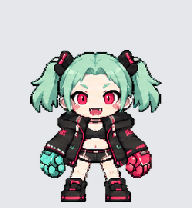
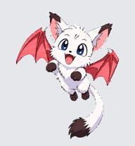

# Codex Pet Chibis

Custom animated pets for the Codex desktop app, collected by Mark Dencler.
Each pet includes the two files needed to install it: `pet.json` and
`spritesheet.webp`. Download one pet or the [complete collection](downloads/all-pets.zip).

| Pet | Preview | Download | Greeting |
| --- | --- | --- | --- |
| Amelia |  | [Amelia ZIP](downloads/amelia.zip) | [Small British flag wave](previews/amelia/waving.gif) |
| Amumu |  | [Amumu ZIP](downloads/amumu.zip) | [Wave](previews/amumu/waving.gif) |
| Hatsune Miku |  | [Miku ZIP](downloads/hatsune-miku.zip) | [Wave](previews/hatsune-miku/waving.gif) |
| Rebecca |  | [Rebecca ZIP](downloads/rebecca.zip) | [Pistol draw and wink](previews/rebecca/waving.gif) |
| Nall |  | [Nall ZIP](downloads/nall.zip) | [Wave](previews/nall/waving.gif) |

The four chibis include the October 11, 2026 animation-size corrections.
Nall is included as an additional custom companion.

## Install a pet

1. Open a pet's ZIP link above, then click **Download raw file** on GitHub.
2. Extract the ZIP. Keep `pet.json` and `spritesheet.webp` together inside the named pet folder.
3. Copy that folder into your Codex pets directory:
   - Windows: `%USERPROFILE%\.codex\pets\`
   - macOS/Linux: `~/.codex/pets/`
   - If you set `CODEX_HOME`, use the `pets` folder inside that directory instead.
4. In Codex, open **Settings → Pets**, refresh the list, and select the pet.

For example, Rebecca should be installed as:

```text
.codex/
  pets/
    rebecca/
      pet.json
      spritesheet.webp
```

If that pet folder already exists, back it up before replacing its two files.
If an update does not appear, refresh or restart Codex so it reloads the sprite sheet.
These instructions describe the local custom-pet layout used by this collection;
the app interface can vary by version.

### Optional PowerShell installer

Download the repository with **Code → Download ZIP**, extract it, and run:

```powershell
./scripts/install-pets.ps1 -Pet rebecca
```

To install the entire collection, run `./scripts/install-pets.ps1` without `-Pet`.
The script verifies the selected sprite checksums and refuses to overwrite an
existing pet folder. You can specify a custom destination with `-PetsDirectory`.

## Files and animation format

- `pets/<id>/`: installable metadata and transparent sprite sheet.
- `downloads/`: one ZIP per pet and a combined ZIP containing all five.
- `previews/<id>/`: thumbnails and GIFs for all nine standard animations.
- `catalog.json`: names, descriptions, download paths, and sprite SHA-256 hashes.
- `SHA256SUMS.txt`: checksums for the published files.
- [FORMAT.md](FORMAT.md): atlas layout and animation rows.

All pets use `spriteVersionNumber: 2`, an 8 × 11 atlas of 192 × 208 cells,
and a 1536 × 2288 transparent WebP image. No image-generation service or API key
is needed to install them. Preview GIFs have a gray background for readability;
the installable sprite sheets are transparent.

## Verification

The published sheets match the installed local versions byte for byte. Atlas
dimensions, used cells, transparency, ZIP contents, and checksums were checked.
The four size-corrected chibis also passed independent static visual review.
Live Codex rendering and timed app playback were not independently verified.

After downloading the repository, you can verify file integrity with Python 3:

```text
python scripts/verify.py
```
